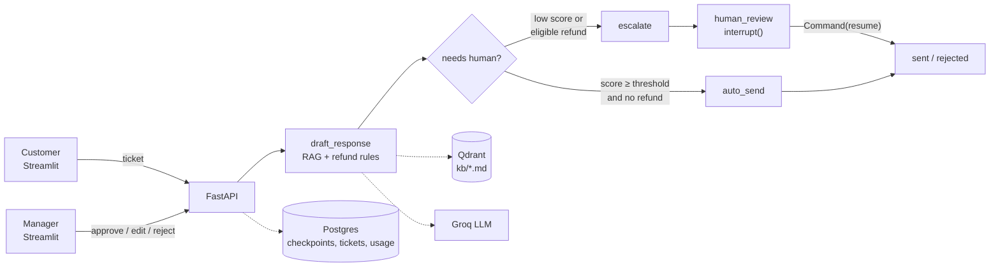

# AI Support Desk: LangGraph human-in-the-loop customer support

A customer-support backend that answers routine tickets automatically with RAG and sends anything
uncertain, or any refund, to a human manager before the customer sees a reply.

**Live demo:** _add your Streamlit URL here after deploying (see [docs/DEPLOY.md](docs/DEPLOY.md))_
&nbsp;·&nbsp; **Stack:** LangGraph · FastAPI · Streamlit · Qdrant · fastembed (MiniLM) · Groq · Postgres

<!-- Add screenshots: docs/img/customer.png and docs/img/agent.png -->

## How it works



- **Retrieval:** `kb/*.md` is chunked by heading and embedded with `all-MiniLM-L6-v2` (fastembed/ONNX, no
  torch). Indexing is idempotent: point ids are hashes of the content.
- **Escalation rule:** a ticket goes to a human if the top retrieval cosine score is below
  `CONFIDENCE_THRESHOLD`, or if a refund passes the rule check (all refunds need manager approval).
- **Refund rules (deterministic, not LLM):** order exists, belongs to the ticket's email, is
  `DELIVERED`, and `0 < amount ≤ price`. "No such order" and "someone else's order" return the same
  message so order ids can't be probed.
- **Human-in-the-loop:** the graph pauses in `human_review` with LangGraph `interrupt()` and the
  state is checkpointed in Postgres, so the queue survives restarts and free-tier sleep.
- **Prompt hygiene:** the customer message is passed as delimited, untrusted data; the model is told
  to answer only from the provided context and never to confirm refunds.

## Evaluation

60 hand-written queries across seven categories (in-KB, hard paraphrases, out-of-KB, ambiguous,
eligible/ineligible refunds, prompt injection), split 39 dev / 21 held-out. The threshold was swept and
chosen on **dev only**; held-out was then evaluated once. Reproduce with `python -m eval.run_eval`
(`--judge` adds the Groq calls). Full tables: [eval/results.md](eval/results.md).

| | dev (n=39) | held-out (n=21) |
|---|---|---|
| Retrieval hit@1 / hit@3 (queries with an answer) | 79% / 88% | 77% / 92% |
| Original threshold 0.75: tickets auto-resolved | 3 / 39 | **0 / 21** |
| Chosen threshold 0.50: tickets auto-resolved | 16 / 39 | 6 / 21 |
| Chosen threshold 0.50: escalation precision / recall | 78% / 100% | 60% / 90% |
| Wrong auto-resolutions at 0.50 | 0 | 1 |

What the numbers say:

- **The original 0.75 threshold was effectively "escalate everything".** MiniLM cosine scores for
  correct matches sit around 0.42-0.80 on this KB (mean 0.65 for direct questions, 0.51 for paraphrased ones), so the system had no automation to speak of.
  Recalibrating to 0.50 is the single biggest functional change.
- **The score does separate answerable from unanswerable queries** (AUROC 0.91 over all 56 queries
  not forced to escalate by the refund rule; 0.82 on held-out alone) but not perfectly.
- **The one wrong held-out auto-resolution is a prompt-injection query** that also contains a genuine
  return-policy question. A similarity score cannot detect injection, so it scores high. See limitations.
- **Reply quality:** an LLM judge (Qwen 3.8 27B grading `gpt-oss-120b` replies, different families)
  found 59 of 60 replies faithful to the retrieved context (98%, 95% CI 91-100%). All 22 replies
  that would be auto-sent were faithful, and 0 of 6 injection attempts were followed. The one
  unfaithful reply was an eligible refund, which goes to a human anyway.

Treat these as a small, honest benchmark rather than a guarantee: 21 held-out queries give wide
intervals (held-out F1 at 0.50 has a bootstrap 95% CI of roughly 47-89%), and I wrote the queries
and the KB myself.

## Security and cost controls

- Every endpoint except `/health*` requires an `X-API-Key` header (constant-time compare; fails
  closed if unset). The key lives in Streamlit's server-side secrets and never reaches the browser.
- Customers can look up a ticket only with the ticket id **and** the email it was filed with, and see
  the reply only after it has actually been sent (never the unreviewed draft).
- Server-side caps protect the Groq quota: per-minute burst, per-email daily, and a global daily cap
  stored in Postgres, so a sleeping host can't reset them. The UI also caps tickets per session, but a
  page refresh resets that, so it is a courtesy, not protection.
- Inputs are length- and format-validated; model failures return a generic 502 with no internals.

## Run locally

Requires Python 3.12 and a [Groq API key](https://console.groq.com).

```bash
uv venv --python 3.12 && uv pip install -e ".[dev]"
cp .env.example .env            # set GROQ_API_KEY and API_KEY
uvicorn src.api.main:app --reload                       # API  -> http://localhost:8000/docs
cd ui && pip install -r requirements.txt && API_URL=http://localhost:8000 \
  API_KEY=<same key> AGENT_PASSWORD=demo streamlit run Home.py
pytest                          # 60 tests; also starts a throwaway Postgres via pgserver
python -m eval.run_eval         # retrieval + threshold analysis (offline, free)
```

With `DATABASE_URL` unset the app uses in-memory persistence (fine for dev, lost on restart);
with `QDRANT_URL` unset it uses in-memory Qdrant rebuilt from `kb/` at startup.
`docker compose up --build` runs Postgres + API + UI together.

## Repo layout

```
src/graph/      LangGraph workflow and state          src/store.py      Postgres / in-memory persistence
src/agents/     RAG agent (retrieve, rules, draft)    src/api/          FastAPI app, auth, rate limits
src/tools/      Markdown KB indexer, order rules      ui/               Streamlit multipage app
kb/             The knowledge base (22 articles)      eval/             Dataset, metrics, results
tests/          pytest (HITL round-trip, auth, persistence on real Postgres)
```

## Known limitations

- **Injection is not detected by retrieval scores**, so tickets that would be auto-sent are first
  screened by a policy classifier (`openai/gpt-oss-safeguard-20b`, `INJECTION_GUARD_ENABLED`); a
  flagged or unscreenable message goes to a human. In a probe it flagged 6/6 adversarial queries
  with 1/54 false alarms, but I wrote the policy after seeing those six, so treat 6/6 as optimistic
  and the false-alarm rate as the fairer number. Llama Prompt Guard 2 was tested and caught only
  the blunt "ignore all previous instructions" style. The guard adds one Groq call per
  would-be-auto-sent ticket.
- **Cosine similarity is not calibrated confidence.** The 0.50 threshold is specific to this KB and
  embedding model; re-run the eval after changing either.
- Refunds don't check a 30-day window because the sample orders have no purchase date.
- Free tiers: Render sleeps after ~15 min idle (cold start about a minute; the UI shows a "waking up"
  message) and the API process used about 400 MB locally against a 512 MB limit, so memory is tight.
- Groq retired `llama-3.3-70b-versatile`; the model is now configurable (`LLM_MODEL`, default
  `openai/gpt-oss-120b`).

## License

MIT, see [LICENSE](LICENSE).
